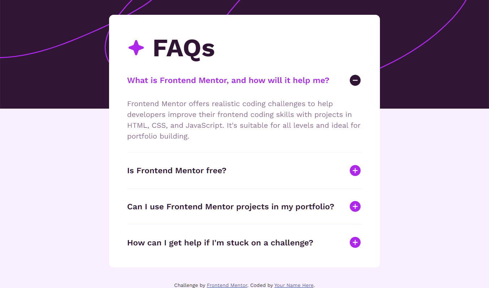

# Frontend Mentor - FAQ accordion solution

This is a solution to the [FAQ accordion challenge on Frontend Mentor](https://www.frontendmentor.io/challenges/faq-accordion-wyfFdeBwBz).

### The challenge

Users should be able to:

- Hide/Show the answer to a question when the question is clicked
- Navigate the questions and hide/show answers using keyboard navigation alone
- View the optimal layout for the interface depending on their device's screen size
- See hover and focus states for all interactive elements on the page

### Screenshot

### Links

- Solution URL: [solution URL](https://github.com/ahmedattlam10/FAQ-accordion)
- Live Site URL: [live site URL](https://ahmedattlam10.github.io/FAQ-accordion/)

### Built with

- Semantic HTML5 markup
- CSS custom properties
- Flexbox
- Mobile-first workflow
- Vanilla-JavaScript

## Author

- Website - [github-profile](https://github.com/ahmedattlam10)
- Frontend Mentor - [FM-profile](https://www.frontendmentor.io/profile/ahmedattlam10)
